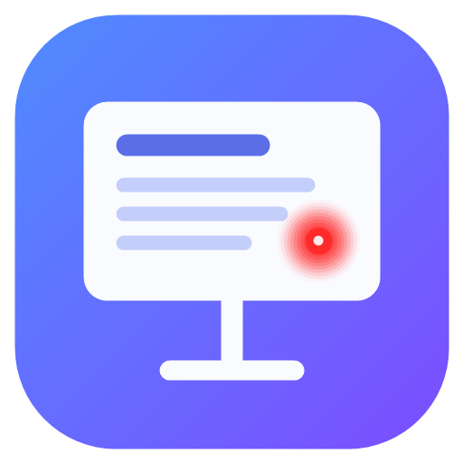

<p align="center">
  
</p>

<h1 align="center">Sunu Pro</h1>

<p align="center">
  Derslere göre düzenlenen, kaldığı yeri hatırlayan, dokunmatik işaretçili<br />
  çift ekran PowerPoint sunum aracı (Windows).
</p>

---

Sunu Pro, PowerPoint sunularınızı **ikinci ekranda (projeksiyon)** PowerPoint'in kendi gösterisiyle
oynatır; **birinci ekranda** ise canlı slayt, konuşmacı notları, sonraki slayt ve işaretleme
araçlarının bulunduğu bir sunucu ekranı açar. Animasyonlar, geçişler ve videolar PowerPoint'teki gibi
çalışır; çünkü gösteriyi PowerPoint'in kendisi oynatır, Sunu Pro onu yönetir.

## Neden?

PowerPoint'in sunucu görünümünde ders anlatırken eksik kalan noktalar için yazıldı:

- **Kaldığın yerden devam:** Derse ara verip dosyayı kapattığınızda hangi slaytta (hatta hangi
  animasyon adımında) kaldığınız kaydedilir; dosyayı yeniden açınca tek tuşla oradan devam edersiniz.
- **Derslere göre kütüphane:** Sunularınızı derslere ayırın, ders klasörünü bağlayın; yeni haftanın
  sunusu klasöre girdiği an listede belirir.
- **Tek tuşla işaretçi:** `1` lazer, `2` vurgulayıcı, `3` kalem, `4` silgi. Tüm tuşlar ayarlardan
  değiştirilebilir.
- **Dokunmatik ekrandan çizim:** Birinci ekranda parmakla ya da kalemle yaptığınız işaretleme
  projeksiyonda gecikmesiz ve aynı konumda görünür.

## Özellikler

- **Canlı PowerPoint modu:** gösteri 2. ekranda PowerPoint ile oynar (animasyon, geçiş, video, ses);
  üstünde Sunu Pro'nun şeffaf çizim katmanı durur. Yedek olarak animasyonsuz **görsel mod**.
- **Sunucu ekranı:** gösterinin canlı yansıması (animasyon adımı dahil), sonraki slayt ve kalan
  animasyon adımı, büyütülebilir notlar, geçen süre (duraklat/sıfırla), saat, slayt ızgarası.
- **İşaretleme:** iz bırakan lazer (renk ve boyut seçilebilir), yarı saydam vurgulayıcı, basınca
  duyarlı kalem, silgi; renk ve kalınlık seçimi; slayt başına geri al/yinele; çizimler slayta bağlıdır
  (slayt değişince saklanır, dönünce geri gelir); istenirse dosya bazında kalıcı.
- **Yakınlaştırma:** iki parmakla büyüt/küçült ve kaydır (ya da Ctrl+tekerlek, `+` / `-`); projeksiyona
  aynen yansır, animasyon durumu korunur, çizimler net kalır. Tam boyuta dönünce parmakla slayt
  değiştirme yeniden çalışır.
- **Dokunmatik, kalem ve fare:** parmakla çizim, kalem (stylus) basıncı, kalemin silgi ucu, avuç reddi,
  araç seçili değilken parmakla kaydırarak slayt değiştirme; fare tekerleğiyle ileri/geri.
- **Ders kütüphanesi:** dersler, klasör bağlama (doğal sıralama: Hafta 1, 2, 10), arka planda ön
  hazırlık (ders anında açılış anlık), son açılanlar.
- **Ara modu (`A`):** projeksiyonda geri sayım ve dönüş saati, süre sayacı durur.
- **Arada kilit:** ara başlayınca bilgisayarın ekranı kilitlenir, **parmak izi / PIN (Windows Hello)** ile
  açılır; projeksiyonda geri sayım sürer. Kilitliyken Windows tuşu, Alt+Tab, Ctrl+Esc, Ctrl+Shift+Esc ve
  Alt+F4 çalışmaz (açık pencerelerin önizlemesi görünmez). Kilit başka bir yoldan aşılmaya çalışılırsa
  (Görev Yöneticisi, dokunmatik/dokunmatik yüzey hareketleri, uygulamayı kapatma...) Windows'un kendi kilidi
  devreye girer; Windows kilidi açılınca Sunu Pro da açılır. Sunum boyunca ekran uykuya geçmez.
- **Ekranlar:** seyirci ekranını seçme, ekranları değiştirme, projeksiyon kablosu çıkarsa gösteriyi
  gizleme ve takılınca kaldığı yerden sürme; tek ekranda test modu.
- **Atanabilir kısayollar:** her eyleme birden çok tuş (sunum kumandasının düğmeleri dahil), çakışma
  uyarısı, varsayılana dönüş.
- **Otomatik güncelleme:** yeni sürümler GitHub üzerinden algılanır, arka planda indirilir.
- **Güvenli:** PowerPoint'te açık belgelerinize dokunmaz; sunu zaten açıksa kaydedilmiş kopyasını
  kullanır.

## Kurulum

1. [Releases](https://github.com/ahmetsuslu/sunupro/releases/latest) sayfasından
   `SunuPro-Setup-x.y.z.exe` dosyasını indirip çalıştırın (kurulumsuz kullanım için
   `SunuPro-x.y.z-portable.exe`).
2. Uygulama imzasız olduğu için Windows SmartScreen uyarı gösterebilir:
   **Ek bilgi → Yine de çalıştır**.
3. Sonraki sürümler kendiliğinden indirilir; "Güncelleme hazır" bildiriminde **Yeniden başlat**'a
   basın ya da uygulamayı kapattığınızda kurulsun.

**Gereksinimler:** Windows 10/11 ve **Microsoft PowerPoint** (Microsoft 365 ile test edildi).
İki ekran önerilir; tek ekranda seyirci görünümü ayrı bir pencerede açılır.

## Kullanım

1. **Yeni ders** oluşturun, sunularınızı ekleyin ya da ders klasörünü bağlayın (klasörü pencereye
   sürükleyip bırakmak da yeterli). Tek seferlik bir dosya için **Sunu aç…**
2. Sunuyu açın: sunucu ekranı açılır. **▶ Sunumu başlat** (`F5`) ya da daha önce kaldıysanız
   **▶ Kaldığın yerden devam**.
3. Seyirci ekranını sağ üstteki ekran menüsünden seçebilir, ekranların yerini değiştirebilirsiniz.

### Varsayılan kısayollar

Hepsi **Ayarlar → Kısayollar**'dan değiştirilebilir.

| Eylem | Tuş |
|---|---|
| İleri (sıradaki animasyon adımı / slayt) | → ↓ PageDown Boşluk Enter |
| Geri | ← ↑ PageUp Geri Sil |
| Animasyonları atlayıp sonraki / önceki slayt | Ctrl+→ / Ctrl+← |
| İlk / son slayt | Home / End |
| Lazer · Vurgulayıcı · Kalem · Silgi | 1 · 2 · 3 · 4 |
| Aracı bırak | 0 |
| Sonraki renk | R |
| Geri al / Yinele | Ctrl+Z / Ctrl+Y |
| Bu slayttaki çizimleri sil | C, Delete |
| Tüm çizimleri sil (onaylı) | Shift+Delete |
| Siyah / beyaz ekran | B veya . / W veya , |
| Slayt ızgarası | G |
| Yakınlaştır / uzaklaştır / tüm slayt | + / - / Z (ayrıca iki parmak, Ctrl+tekerlek) |
| Fare tekerleği | aşağı: ileri, yukarı: geri (Ayarlar'dan kapatılabilir) |
| Ara modu | A |
| Sunumu baştan / bu slayttan başlat | F5 / Shift+F5 |
| Geri çık: arayı / aracı / yakınlaştırmayı kapat; yoksa sunumu bitir (onaylı) | Esc |

## Sorun giderme

- **Gösteri yanlış ekranda:** sunucu ekranındaki ekran menüsünden seyirci ekranını seçin ya da
  **Ekranları değiştir**'e basın.
- **"PowerPoint yanıt vermedi":** PowerPoint'te açık bir uyarı penceresi olabilir; kapatıp tekrar deneyin.
- **Parola korumalı sunu:** PowerPoint'te parolayı kaldırın (Dosya → Bilgi → Sunuyu Koru).
- **Günlük dosyası:** Ayarlar → Hakkında → *Günlük klasörünü aç*
  (`%APPDATA%\Sunu Pro\logs\main.log`). Sorun bildirirken eklemeniz çok yardımcı olur.

## Geliştirme

Electron + electron-vite + React + TypeScript. PowerPoint'e, Windows'ta hazır gelen PowerShell
üzerinden COM otomasyonuyla erişilir (`resources/pptctl.ps1`); yerel (native) modül yoktur.

```bash
npm install
npm run dev          # geliştirme
npm run typecheck    # tip denetimi
npm run test:e2e     # uçtan uca test (PowerPoint + mümkünse iki ekran gerekir)
npm run build:win    # kurulum dosyası ve taşınabilir sürüm → release/
npm run release      # GitHub Releases'e yayın (gh CLI)
```

```
src/main/       Electron ana süreç: pencereler, ekranlar, PowerPoint denetleyicisi, kütüphane, güncelleme
src/preload/    güvenli IPC köprüsü
src/renderer/   arayüz (kütüphane, sunucu ekranı, seyirci katmanı)
src/shared/     ortak tipler ve kısayol eylem kaydı
resources/      pptctl.ps1 (PowerPoint COM denetleyicisi)
scripts/        örnek sunu, simge, uçtan uca test ve yayın betikleri
```

Katkı için [CONTRIBUTING.md](CONTRIBUTING.md) dosyasına bakın.

## Lisans

[MIT](LICENSE) © Ahmet Süslü
